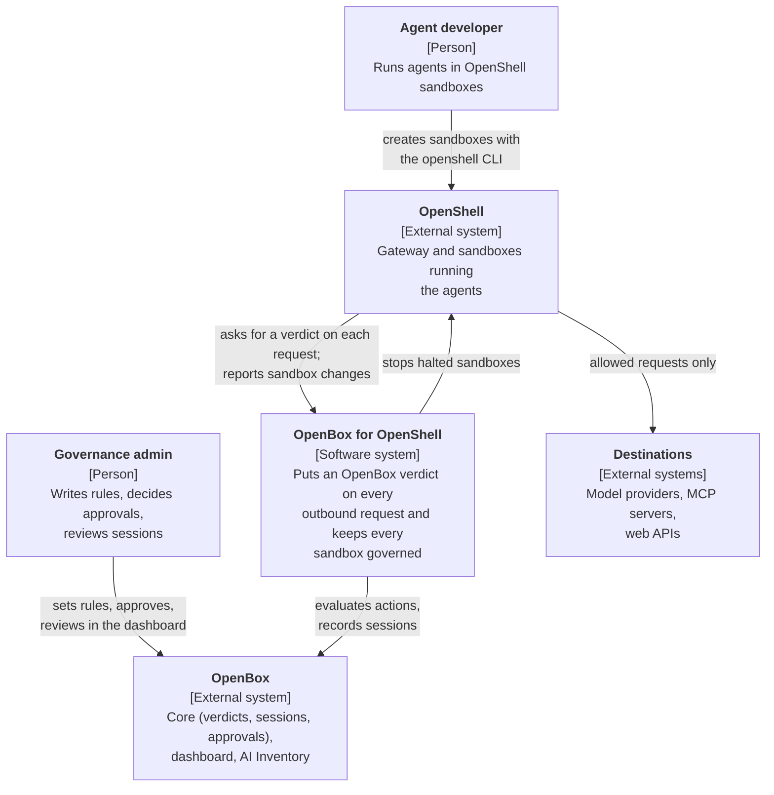
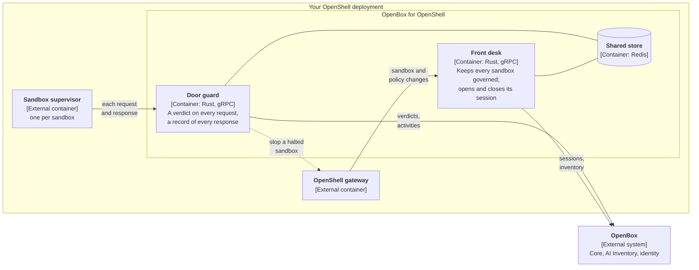
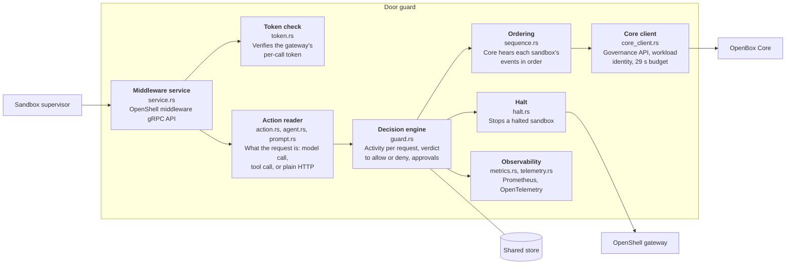
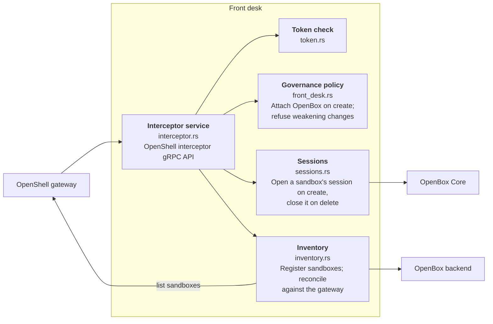

# OpenBox for OpenShell

OpenBox governance for [NVIDIA OpenShell](https://github.com/NVIDIA/OpenShell).

If you already run AI agents in OpenShell sandboxes, this integration puts an
OpenBox verdict in front of everything those agents send out of the sandbox:
model calls, tool calls, web requests. Your OpenBox policies, guardrails,
behaviour rules and approvals apply to every sandbox the gateway creates, and
each sandbox shows up in the OpenBox dashboard as one session you can follow
step by step.

You keep using OpenShell exactly as before. Nothing changes in your sandbox
images, your agents or the `openshell` commands you run.

Built for OpenShell v0.1.8.

## Quick start

Install the published Helm chart next to your gateway. You do not need to
clone this repository or build anything.

**You need**

- An OpenShell v0.1.8 gateway on Kubernetes, with extension tokens on (the
  `[openshell.gateway.gateway_jwt]` section of its TOML). Note its
  `gateway_id` and the PEM file at `public_key_path`.
- An agent in the OpenBox dashboard with a workload identity. The dashboard
  gives you `OPENBOX_API_URL`, `OPENBOX_API_KEY` and
  `OPENBOX_WORKLOAD_PRIVATE_KEY`.
- [cert-manager](https://cert-manager.io) in the cluster, to issue the two
  services' TLS certificates. Already have certificates? See
  [Bring your own certificates](docs/install.md#2-issue-the-server-certificates).
- A Redis every replica can reach. For a first look, the chart can run one
  (`redis.enabled: true` below).
- Helm 3.8 or later.

**1. Store the agent's credentials.** Save the dashboard's private key as
`workload.pem`, ask Core for the key's `kid`, and put the three values in a
Secret:

```sh
curl -fsS -H "Authorization: Bearer $OPENBOX_API_KEY" \
  "$OPENBOX_API_URL/api/v3/auth/bootstrap"        # prints "kid": "..."

kubectl create namespace openbox
kubectl -n openbox create secret generic openbox-agent \
  --from-literal=api-key="$OPENBOX_API_KEY" \
  --from-file=workload.pem=workload.pem \
  --from-literal=workload-kid=<kid>
```

**2. Create a CA for OpenBox.** The gateway and the sandbox supervisors check
both services' certificates against a CA you name in the gateway's TOML. This
makes a dedicated one with cert-manager and saves its certificate as
`openbox-ca.pem`:

```sh
kubectl -n openbox apply -f - <<'EOF'
apiVersion: cert-manager.io/v1
kind: Issuer
metadata: {name: openbox-selfsigned}
spec: {selfSigned: {}}
---
apiVersion: cert-manager.io/v1
kind: Certificate
metadata: {name: openbox-ca}
spec:
  isCA: true
  commonName: OpenBox for OpenShell CA
  secretName: openbox-ca
  duration: 87600h
  privateKey: {algorithm: ECDSA, size: 256}
  issuerRef: {name: openbox-selfsigned, kind: Issuer}
---
apiVersion: cert-manager.io/v1
kind: Issuer
metadata: {name: openbox-ca}
spec: {ca: {secretName: openbox-ca}}
EOF

kubectl -n openbox wait --for=condition=Ready certificate/openbox-ca
kubectl -n openbox get secret openbox-ca -o jsonpath='{.data.ca\.crt}' \
  | base64 -d > openbox-ca.pem
```

**3. Install the chart.** Save this as `openbox-values.yaml`:

```yaml
openbox:
  url: https://<OpenBox Core URL>
  backendUrl: https://<OpenBox backend URL>   # AI Inventory
credentials:
  existingSecret: openbox-agent
gateway:
  id: <gateway_id>
tls:
  certManager:
    enabled: true
    issuerRef: {name: openbox-ca}
redis:
  enabled: true        # evaluation only; use externalRedis.url in production
```

```sh
helm install openbox oci://ghcr.io/openbox-ai/charts/openbox-openshell \
  --version 0.1.0 -n openbox -f openbox-values.yaml \
  --set-file gateway.publicKey=<public_key_path>

kubectl -n openbox wait --for=condition=Available deploy --all --timeout=3m
```

The chart refuses a configuration the services would refuse at startup, and
tells you which value is missing. `helm show values
oci://ghcr.io/openbox-ai/charts/openbox-openshell` lists every value.

**4. Register OpenBox with the gateway.** `helm install` prints three TOML
blocks with your Service names filled in. Add them to the gateway's TOML, set
each `tls_ca_cert_path` to where the gateway can read `openbox-ca.pem`, and
restart the gateway. OpenBox must be running first: the gateway does not start
while a registered service is unreachable.

**5. Create a sandbox as usual, and check it is governed.**

```sh
openshell sandbox create --name check --policy policy.yaml
openshell policy get check --full | grep 'middleware: openbox'
```

Requests from the sandbox now get an OpenBox verdict, and the sandbox shows up
as a session on the agent in the OpenBox dashboard. Write your policies,
guardrails and behaviour rules on that agent; they apply to all its sandboxes.

**Next:** `docs/install.md` covers the gateway API client certificate (needed
to stop a halted sandbox), bringing your own certificates, the VM compute
driver, and SIEM forwarding. `docs/agent-approvals.md` is the guide to give agent authors.
No Kubernetes? See [Try it on one machine](#try-it-on-one-machine).

## What you get

- **A verdict on every outbound request.** Before a request leaves a sandbox,
  OpenBox decides: allow it, block it, hold it for a person to approve, or halt
  the whole sandbox.
- **Governance nobody can switch off from inside.** Every new sandbox is
  attached to OpenBox automatically. A policy change that would remove or
  weaken that attachment is refused.
- **A readable record.** Each sandbox is one OpenBox session: the user's
  prompts, each model call, each tool the model asked for, and the requests
  made inside that tool, in order, with their inputs, outputs and timing.
- **An inventory.** Every sandbox is registered in the OpenBox AI Inventory
  and kept up to date as it changes and is deleted.
- **Fail closed.** If OpenBox cannot give a verdict in time, the request is
  denied with an explicit reason, never silently allowed.

## What an agent in a sandbox sees

| OpenBox decides | The request | The agent sees |
|---|---|---|
| Allow | goes out | the normal response |
| Allow with a constraint | goes out; the constraint is recorded | the normal response |
| Block | does not go out | HTTP 403, reason code `openbox_blocked` |
| Require approval | does not go out yet | HTTP 403, `openbox_approval_required`. Retrying the identical request after a person approves it lets it through |
| Halt | does not go out | HTTP 403, `openbox_halted`. The sandbox is stopped, and nothing else from it gets out |
| No verdict in time | does not go out | HTTP 403, `openbox_unavailable` |

OpenShell cannot hold a request open while a person decides, so approval is
deny-then-retry. `docs/agent-approvals.md` is the guide to give agent authors.

## Architecture

The views below follow the [C4 model](https://c4model.com): the system in its
surroundings, then the deployable pieces, then the parts inside them.

### Level 1: System context

Who uses OpenBox for OpenShell, and which systems it sits between.



### Level 2: Containers

Two services, deployed together beside the OpenShell gateway.



| Container | Talks to | Listens on | Registered with the gateway as | On failure |
|---|---|---|---|---|
| Door guard | OpenBox Core over HTTPS with the agent's workload identity; the gateway API over mTLS to stop a halted sandbox | `:50051` gRPC, plus an admin port for `/metrics` and health | `[[openshell.supervisor.middleware]]` named `openbox`, `timeout = "30s"` | Fail closed: requests are denied |
| Front desk, governing | – | `:50061` gRPC | `[[openshell.gateway.interceptors]]` named `openbox` | Fail closed: sandbox creates and policy changes are refused |
| Front desk, recording | OpenBox Core (sessions) and the AI Inventory API over HTTPS; the gateway API over mTLS to reconcile | `:50062` gRPC | `[[openshell.gateway.interceptors]]` named `openbox-inventory` | Fail open: the change still happens; the inventory catches up on reconcile |
| Shared store | – | Redis | – | Nothing is skipped; an approval's retry may need approving again |

Run two or more door guard replicas behind the shared store. With
`fail_closed`, OpenBox availability is sandbox availability: plan for it the
way you plan for the gateway. `docs/runbook.md` covers operating it.

### Level 3: Components

#### Door guard



One request, start to finish:

1. The supervisor sends the request (method, URL, headers, body up to the
   registered `max_payload_bytes`) to the door guard, with a short-lived
   gateway token.
2. The door guard works out what the request is. A call to a model provider
   is the agent thinking (`llm_call`); a call the model asked for is a tool;
   anything else is plain HTTP inside the current tool.
3. It opens that activity in the sandbox's OpenBox session and asks Core for a
   verdict, all within one 29 s budget so the answer always beats OpenShell's
   30 s timeout.
4. The verdict becomes allow or deny with a reason code. A halt also stops the
   sandbox through the gateway.
5. When the response comes back, the door guard records it and closes the
   activity. If the model's reply asked for tools, it opens them.

#### Front desk



On every new sandbox the front desk adds an `openbox` entry to its network
policy: every host, fail closed, after any middleware you run yourself. A
sandbox created without `--policy` gets OpenShell's restrictive default with
OpenBox attached. The front desk refuses:

- a policy whose `openbox` entry is missing, replaced, or not fail closed
- endpoints that would send credentials without inspection
- automatic approval of policy changes the agent proposes for itself

### Level 4: Code

The crate is in `middleware/`, one module per component above. Each module
starts with a comment saying what it owns.

## What is not governed

Some traffic gets an allow or deny by host and port only, without a
per-request verdict:

- raw TCP (`protocol: tcp`, for example Postgres or SSH)
- hosts marked `tls: skip`, which OpenShell cannot inspect
- WebSocket messages after the upgrade request (`docs/websocket.md`)

Put internal systems behind HTTP or MCP to govern them per request.
`docs/install.md` lists the remaining known limits.

## Repository

| Path | What |
|---|---|
| `middleware/` | Both services (one Rust crate), tests and examples |
| `Dockerfile` | The image: both services, distroless, UID 65532 |
| `deploy/helm/openbox-openshell/` | Helm chart for both services |
| `.github/workflows/` | CI, and the release that publishes the image and chart |
| `docs/install.md` | Install on your OpenShell gateway |
| `docs/runbook.md` | Metrics, alerts, slow verdicts, break-glass |
| `docs/agent-approvals.md` | Approvals, for agent authors |
| `docs/websocket.md` | What is governed on a WebSocket |
| `middleware/scripts/openbox-openshell.sh` | Run OpenShell governed by OpenBox on one machine |
| `middleware/scripts/verify-*.sh` | Live checks against a real gateway and OpenBox |

## Try it on one machine

With the OpenShell v0.1.8 binaries installed and an agent's credentials saved
from the dashboard as `agent.env`:

```sh
middleware/scripts/openbox-openshell.sh up --agent-env agent.env
middleware/scripts/openbox-openshell.sh demo
middleware/scripts/openbox-openshell.sh down
```

`up` starts a local gateway with both services registered. `demo` runs a short
agent session in a sandbox; open the agent in the OpenBox dashboard to see it.
Set `OPENSHELL_PREFIX` to the directory holding `bin/openshell`,
`bin/openshell-gateway` and `libexec/openshell-driver-vm`. This setup is for
development only: it runs without TLS between the gateway and the services.

## Releases

Each release publishes:

| What | Where |
|---|---|
| Image, `linux/amd64` and `linux/arm64` | `ghcr.io/openbox-ai/openbox-openshell:<version>` |
| Helm chart | `oci://ghcr.io/openbox-ai/charts/openbox-openshell --version <version>` |
| Notes and the packaged chart | [GitHub Releases](https://github.com/OpenBox-AI/openbox-openshell/releases) |

The chart's version, its `appVersion` and the image tag are always the same,
so a chart installs the image it was released with. A stable release also
moves `<major>.<minor>`, and the newest stable release moves `latest`.
Release candidates (`X.Y.Z-rc.N`) move neither and are marked as prereleases.

The image and the chart are signed with [cosign](https://docs.sigstore.dev)
by the release workflow, and the image carries an SBOM and build provenance.
Check a release before you install it:

```sh
cosign verify ghcr.io/openbox-ai/openbox-openshell:<version> \
  --certificate-identity-regexp '^https://github.com/OpenBox-AI/openbox-openshell/\.github/workflows/release\.yml@refs/tags/v' \
  --certificate-oidc-issuer https://token.actions.githubusercontent.com
```

The same command with `ghcr.io/openbox-ai/charts/openbox-openshell:<version>`
checks the chart.

To cut a release:

1. Set `version` and `appVersion` in `deploy/helm/openbox-openshell/Chart.yaml`
   and `version` in `middleware/Cargo.toml` to the new version, and run
   `cargo update -p openbox-verdict-middleware` in `middleware/` so
   `Cargo.lock` follows.
2. Merge, then push a `v<version>` tag on `main`.

The release workflow refuses a tag that does not match all three. It also runs
as a dry run on every pull request that touches what a release ships: both
images are built and smoke-tested, and the chart is packaged, with nothing
pushed.

## Build and test

```sh
cd middleware
cargo fmt --check
cargo clippy --locked --all-targets -- -D warnings
cargo test --locked
```

To build the image yourself, run `docker build -t openbox-openshell .` from
the repository root, push it to your registry, and install the chart with
`--set image.repository=<registry>/openbox-openshell --set image.tag=<tag>`.

## License

MIT. See [`LICENSE`](LICENSE).
